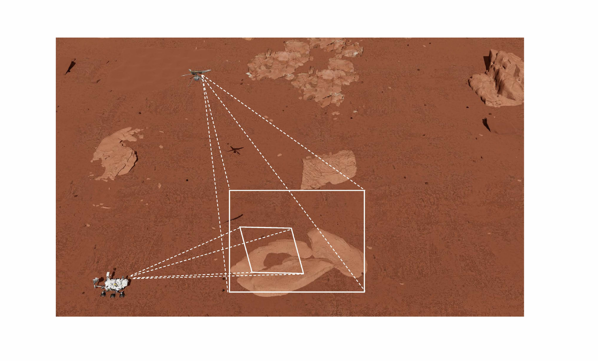
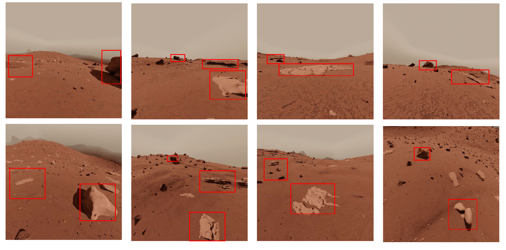

# SynMars-GA

We release a preview of **SynMars-GA**, a synthetic ground–air paired dataset for cross-view collaborative localization on Mars. It extends our previous [SynMars](https://github.com/CVIR-Lab/SynMars) dataset series to collaborative observations from a Mars helicopter and rover. SynMars-GA contains a total of **10,000 ground–air image pairs**. It was collected from a simulation environment generated by [Blender](https://www.blender.org/), an open source and versatile 3-D computer graphics software allowing users to create and arrange 3-D objects.

  
   
  <strong>Fig.1.</strong>
  <em>A scene with the Mars helicopter and rover on the SynMars-GA simulation platform. The dashed lines illustrate their different viewing perspectives.</em>

The simulated environment is a Mars-like terrain containing rocks and sandy surfaces. In each scene, virtual cameras on the helicopter and rover capture the same terrain from different perspectives, providing paired aerial and ground observations for cross-view image translation and collaborative localization. We show four examples of ground–air image pairs below.

  
   
  <strong>Fig.2.</strong>
  <em>Examples of image pairs in the SynMars-GA dataset. Each column shows a ground–air image pair, and the red boxes highlight corresponding rocks observed from the two viewpoints.</em>

Besides the paired images, SynMars-GA provides object annotations, depth information and precise camera pose parameters. It can therefore support downstream vision tasks such as depth estimation, stereo vision and 3D reconstruction.

Currently, we provide only selected example figures of **SynMars-GA**. The full dataset will be released after the associated paper is accepted.

**SynMars-GA: Coming soon.**

Citation information will be updated after the paper is accepted.
